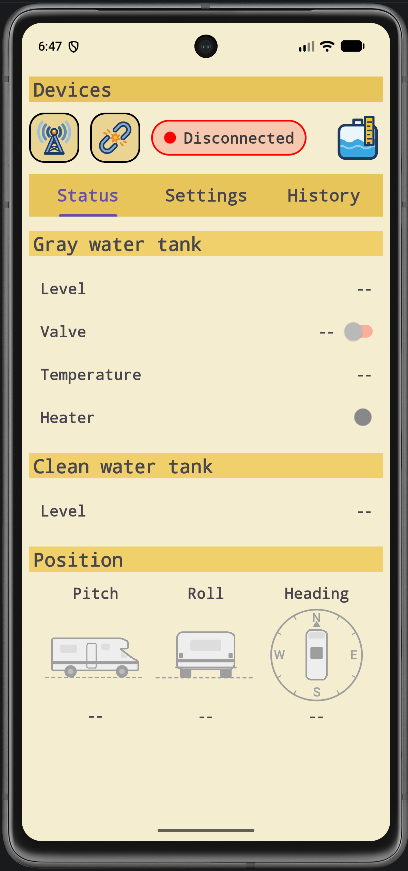
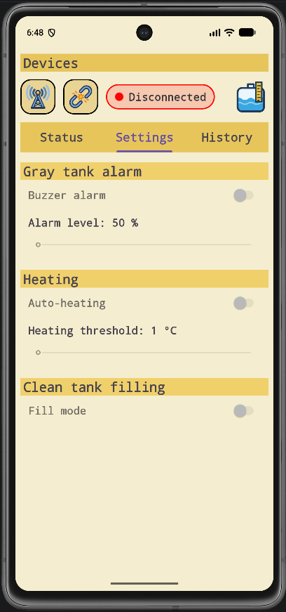
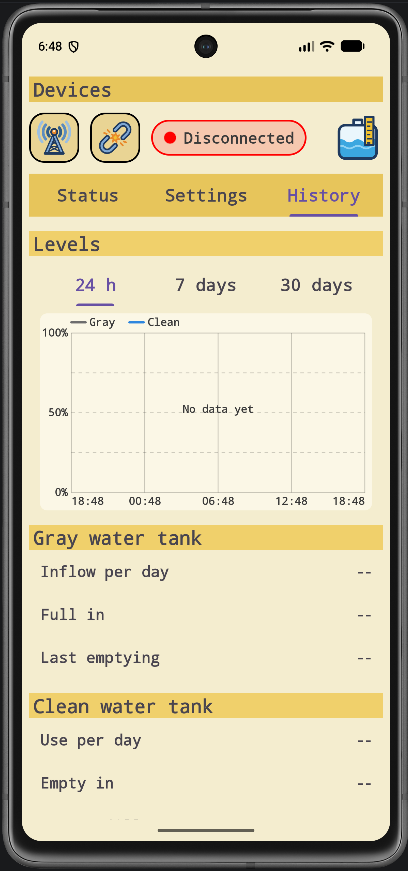

# Tank Manager App

Android app for a camper/RV water tank management system. It connects over Bluetooth LE to an
ESP32 controller that monitors the gray and clean water tanks, drives the gray tank drain valve
and a tank heater, and reports the vehicle's tilt.

The firmware, PCBs and enclosure live in the sibling repository
[Tank-Manager-Design](https://github.com/TheGrycek/Tank-Manager-Design).

## Features

- **Status**: gray and clean tank levels, gray tank temperature, heater state, and a valve switch
  that shows both the commanded and the actual valve state (closed, open, moving, error).
- **Position**: the camper's pitch, roll and magnetic heading, drawn from the side, from behind
  and on a compass, coloured by how level the vehicle is.
- **Settings**: buzzer, gray level alarm threshold, auto-heating and its threshold, and the clean
  tank fill mode (the buzzer beeps faster as the tank fills).
- **History**: gray/clean level and temperature charts for 24 hours, 7 or 30 days, with fill and
  drain rates, "full in" / "empty in" forecasts and refill/emptying events. History is
  downloaded from the controller and kept on the phone, so it is available offline.
- **Background connection**: the link runs in a foreground service, survives closing the screen
  and reconnects automatically when the controller comes back in range or Bluetooth is switched
  back on.
- **Secure pairing**: every characteristic requires an authenticated, bonded LE Secure
  Connections link; the 6-digit passkey is shown on the controller's display.

## Screenshots

| Status | Settings | History |
|:------:|:--------:|:-------:|
|  |  |  |

## Requirements

- Android 7.0 (API 24) or newer with Bluetooth LE.
- A Tank Manager controller running the firmware from
  [Tank-Manager-Design](https://github.com/TheGrycek/Tank-Manager-Design).
- Permissions: *Nearby devices* on Android 12+, or *Location* (with Location Services switched
  on) on Android 7–11, which Android requires for BLE scanning.

## Usage

1. Power the controller and open the app.
2. Tap the devices button and pick the controller (it advertises as `Mati&Mati`). Only devices
   offering the Tank Manager service are listed.
3. On the first connection Android asks for a pairing code; enter the 6 digits shown on the
   controller's OLED.
4. Values appear within a couple of seconds. The session stays active until you tap
   **Disconnect** in the app or in the notification.

The controller accepts one phone at a time and stops advertising while connected.

## Building

The project is a single Gradle module (`:app`) written in Java with XML layouts.

- Gradle 9.8.1 (wrapper), Android Gradle Plugin 9.4.1
- compileSdk / targetSdk 35, minSdk 24, Java 11
- A JDK 17 or newer to run Gradle (Android Studio's bundled JBR works)

```bash
./gradlew assembleDebug          # build the debug APK
./gradlew installDebug           # install it on a connected device
./gradlew test                   # JVM unit tests
./gradlew lint
```

If `java` is not on your `PATH`, point `JAVA_HOME` at Android Studio's JDK first, for example:

```bash
export JAVA_HOME=~/.local/share/JetBrains/Toolbox/apps/android-studio/jbr
```

Bluetooth LE cannot be tested on an emulator; use a real phone and the controller board.

## Project structure

```
app/src/main/java/com/example/tank_manager/
├── MainActivity      main screen: Status, Settings and History tabs
├── BTListActivity    BLE scan list
├── TankService       foreground service owning the GATT connection
├── Protocol          BLE UUIDs and payload encoding/decoding
├── HistoryStore      SQLite storage of the level history
├── HistoryStats      rates, forecasts and events from the history
├── HistoryChart      history chart view
└── TiltView          pitch / roll / heading drawing
tools/gen_icons.py    generates all app and launcher icons
images/               README screenshots
```

## BLE protocol

The controller exposes the service `19b10000-e8f2-537e-4f6c-d104768a1214` with characteristics
`00000000-0000-0000-0000-00000000000N` (little-endian values):

| N | Name | Payload | Meaning |
|---|------|---------|---------|
| 1 | CLEAN_LEVEL_SENSOR | uint8 | clean tank level, 0–100 % |
| 2 | GRAY_LEVEL_SENSOR | uint8 | gray tank level, 0–100 % |
| 3 | GRAY_TEMP_SENSOR | int16 | gray tank temperature in °C × 100, `-32768` = sensor fault |
| 4 | MPU_SENSOR | 3 × float32 | pitch, roll, heading in degrees |
| 5 | VALVE | uint8 | valve command / target: 0 = close, 1 = open |
| 6 | VALVE_STATE | uint8 | 0 closed, 1 open, 2 closing, 3 opening, 4 error |
| 7 | HEATER | uint8 | 1 = heater on |
| 8 | SETTINGS | 5 × uint8 | buzzer, alarm threshold, auto-heating, heating threshold, fill mode |
| 9 | HISTORY | variable | level history download |

The protocol is shared with the firmware; any change has to be made in both repositories.
[CLAUDE.md](CLAUDE.md) describes it in full detail.

## License

[MIT](LICENSE) © 2025 Mateusz Grycmacher
